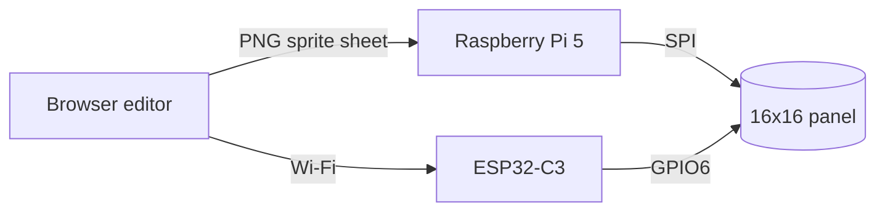
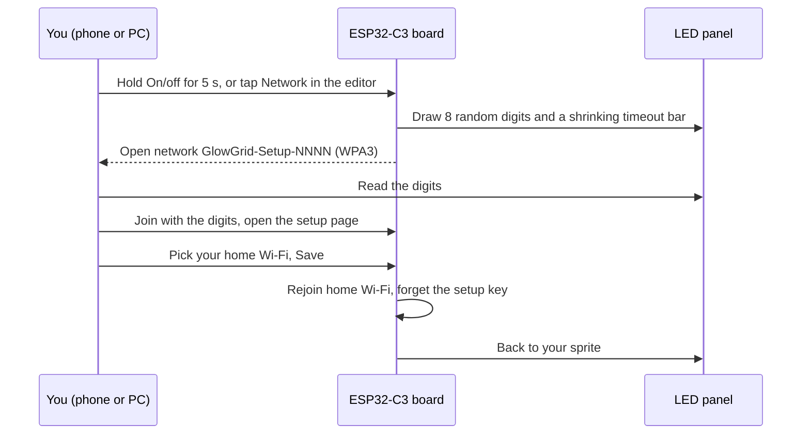

Bare LEDs make bad pixels. A 16x16 WS2812B panel has 256 of them, each a hard little point of light, and a sprite on that panel looks like a sprite drawn with tiny flashlights. I wanted something that looked like a pixel: soft, square, and something I could draw on my phone and put on a desk.

That turned into four things: a pixel editor that runs in a browser, a player on a Raspberry Pi 5, a second player on an ESP32-C3 that needs no computer at all, and a 3D-printed case with a black grid and a white diffuser cover. All of it is open source, and the case files are on [Printables](https://www.printables.com/model/1884854-glow-grid-16x16-led-panel-case-frame-grid-diffuser).

## Why I built this

This is another hardware project where I've directed Claude through the implementation instead of writing the code myself. The first was an [LED strip controller](/posts/led-strip/). I have a CS degree, but coding was never the part I loved. I like building things and solving problems, and for years the typing ate the time I would have spent on the problem.

The strip was easy. The next step, a 256-pixel panel, was supposed to be the same thing with more LEDs: same Pi, same driver. It wasn't, and the way it failed taught me more than anything else in this build.

## What you'll need

You don't need everything to try the editor, which runs in any browser. For the hardware:

- **Panel:** a 16x16 WS2812B flexible LED matrix, 256 pixels, 10 mm pitch. I used a "DC5V WS2812 Digital Flexible RGB Matrix Screen Module Light, 16x16". Measure yours before printing: the frame pocket is 162 mm square, and panels from different sellers vary.
- **Power:** a 5 V supply rated for addressable LEDs, 6 A, with a 5.5 x 2.5 mm barrel plug, center positive, and a UL or ETL mark. I learned the hard way that a generic 2 A adapter is not enough (more on that below).
- **Controller:** a Raspberry Pi 5, or an ESP32-C3 SuperMini (24 x 18 mm, USB-C) with its stick-on Wi-Fi antenna. SuperMini clones vary, so print the holder first and test the fit.
- **Case hardware:** a panel-mount DC jack for a 12 mm hole, two panel-mount push buttons for 12.3 mm holes (check the body length first), a 1N5819 Schottky diode, 18 AWG wire for the panel power and 22 AWG for the C3.
- **Cradle:** four M3 x 8 mm screws (not M3 x 10, which poke through) and about 1 mm of double-sided tape.
- **Printer:** a 3D printer and PLA. Mine is an ELEGOO Neptune 4 Pro. The frame takes about 2 hours 40 minutes and 125 g, the grid about 2 hours 30 minutes and 45 g, the cradle about 1 hour 40 minutes, the cover about 30 minutes.

## The bug that looked like hardware

My first 256-pixel panel was an 8x32. It worked at first, then random pixels started lighting up in the wrong colors, more of them as I ran more patterns. I did what you'd do. I added a series resistor, which helped a little. I added a 74AHCT125 level shifter, which made things worse, and I took it out. I moved a big capacitor around the board. I worked out that the noise was at the input end of the panel, not the far end, which ruled out one theory and pointed at nothing in particular.

What I eventually blamed was the power supply. I'd been running the panel from a generic 5 V, 2 A wall adapter, and it got hot enough that I came close to melting the panel. Replacing it with a 6 A supply made for LEDs was the right call, and it also is a real safety lesson: don't size a supply by average current, because LED current comes in sharp spikes, and a cheap adapter with a poor transient response can't hold the rail steady.

It wasn't the whole story. When I moved to the 16x16 panel with the proper supply, no breadboard and a resistor on the data line, the same symptoms came back. A static check pattern was mostly right but had different wrong pixels on every run. A solid-red fill of all 256 LEDs looked fine for about five seconds and then grew yellow columns at the input end while nothing was touched.

The symptoms pointed at the electronics, and the cause was in software. The library that drives the panel, `rpi5-ws2812`, sends one SPI byte for every WS2812 data bit, so a frame for 256 LEDs is 42 preamble bytes plus 24 bytes per LED, which is **6,186 bytes**. Linux's default `spidev` buffer is **4,096 bytes**. Every frame went out as two separate writes with a scheduler-dependent pause between them, landing 7 bits into LED 168. Depending on the length of that pause, the LEDs either rode through it or treated it as the end of the frame and re-applied the second half from LED 0. Solid red shifted by a few bits turns green bits on, and red plus green is yellow.

That is why the same driver worked on my 60-LED strip: 60 LEDs is 1,482 bytes, which never crosses the limit.


Append `spidev.bufsiz=65536` to the single line in `/boot/firmware/cmdline.txt` and reboot. Check it with `cat /sys/module/spidev/parameters/bufsiz`. Wire data to GPIO10 (pin 19), share a ground, and power the panel from its own supply, never from the Pi's 5 V. No resistor, capacitor, or level shifter is needed in the final build.


What found it was a 40-line test script: solid red, 256 LEDs hard-coded, none of the application's image, mapping, or gamma code. If the fault survived in that, the application wasn't the cause. Then I read the driver and the `spidev` source, which showed the split. Reading the source first would have saved two evenings of suspecting contacts, ground, the level shifter, and the capacitor.

Two things I can't fully say. The 8x32 shared the same driver, the same frame size and almost certainly the same 4,096-byte limit, but it's out of service, so I never retested it. The supply and the buffer both mattered there, and I can't prove how much each did. And the level shifter got recommended to me *again* on the 16x16, before anyone consulted notes from the first panel. I've since written the lesson down where the project can see it: read the driver and write a minimal control before you buy a part. The level shifter stays in the build notes as a fallback if a particular panel flickers, but this one doesn't need it.

## The editor

The editor is a web page. It runs from GitHub Pages, installs as an app on a phone, and works offline: [dwooods.github.io/glow-grid](https://dwooods.github.io/glow-grid/). You draw on a 16x16 grid, add frames to animate, and export a small PNG that carries its own settings (frame count, frame rate, brightness, gamma) inside the file instead of in the file name. I'd originally put those in the name, `knight_4fps_bright0.35_gamma2.2.png`, until I asked why a file needed a name to know how fast to play.

A few decisions are worth explaining.

**Photos need an LED-aware import.** Shrinking a photo to 16x16 with the browser's default smoothing doesn't match what the Pi will do, so the editor has its own area-average resize, checked against Pillow to within one level out of 255. At brightness 0.3 and gamma 2.2, 256 input levels collapse into about 77 LED levels, and every dark shade ends up at 1 to 3 out of 255. Rounding each pixel on its own makes dark gradients band, so the dithering works in LED space, not color space.

**Illustrations need a different import.** Averaging is right for photos and wrong for flat art: outlines blend into muddy in-between colors. So the import has a flat-art mode that picks a few main colors first and gives each LED whichever one covers most of its cell.

**A phone layout I got wrong.** I built a locked, no-scroll layout with the tools in a bottom dock. It looked right at three simulated phone sizes. On a real iPhone, a finger on the grid painted instead of scrolling, and there was no other place to swipe. The fix removed code instead of adding it: the settings sheet became normal cards below the strip, and the page scrolls. I'd rated that layout 7.5 out of 10 while the settings couldn't be reached on a phone, which is why the editor now has a written rubric. A score based only on a screenshot can't go above a 3 out of 4 on any dimension, and a phone score needs a real phone.

**Examples are original.** The example sprites in the repo (a campfire, a cauldron, a jack-o'-lantern, fireworks, meteors, lightning) are all drawn from scratch, and none of them is someone else's character.

## What it can show

The sprites that ship with the repo are all drawn as text in a Python file, one character per pixel, so they live in git as source and not as binary images. Four of them, rendered here from that data with a soft glow added (this is a preview render, not a photo of the panel):

  
  
  
  

The last one, a missile-defense scene, on the real panel, filmed on my phone:

<video autoplay loop muted playsinline controls preload="metadata" width="100%" poster="/images/glow-grid-missile-defense-real-panel.gif" style="max-width:480px;display:block;margin:1em auto;">
  <source src="/images/glow-grid-missile-defense-real-panel.mp4" type="video/mp4">
  
</video>

## Two players

**The Pi player** reads the exported PNGs from a folder and plays them through a terminal menu. It's the simplest setup, and it needs the Pi plugged in and reachable over SSH.

**The ESP32-C3 player** is the one meant to live inside the case. It stores about 100 sprites in its own flash, drives the panel directly, and serves its own copy of the editor over your home Wi-Fi, so you can open it from a phone without a computer. Two buttons change what's showing: Next, and On/off. Holding On/off for five seconds opens Wi-Fi setup.

### Getting a screenless board onto Wi-Fi

The setup network is the part I thought about longest. A board with no screen has no good place to show a password, and a password printed on a label is the same on every unit. So when you open setup, the board creates a new WPA3 network with a random name and a random 8-digit password, and draws the digits on the LED panel. If you can read them, you're standing in front of the device. The password lives in RAM only and is gone when setup ends or five minutes pass.

I tested it on a Windows 11 PC and an iPhone. The iPhone opens the setup page by itself. On Windows 11 you get an "Action needed" entry and have to click it. I haven't tested Android, so I don't claim it works there.

The first real run of the setup page showed "Loading..." forever, on both the PC and the iPhone. I assumed the new WPA3 network was the culprit and built a WPA2 comparison version to prove it. It wasn't. The F12 console on the PC showed a JavaScript syntax error: an apostrophe inside a single-quoted string had stopped the entire page script from running. That bug had shipped for four firmware versions, and every test had passed because the tests compared the page's text instead of running its code. The fix was one character. The test that prevents it runs `node --check` on the page script. The new feature was the suspect, and old unchanged code was guilty.

### One name per board

A latent bug sat in the firmware until I asked the right question. Every board called itself `glowgrid` and advertised `glowgrid.local` over mDNS. With one board that's a nice address. With two boards on the same home Wi-Fi (two kids, two rooms) they fight over the name, and whoever wins the race gets the other person's sprites. One hard-coded `#define` was the whole problem.

The fix: each board now names itself `glowgrid-` plus the last two bytes of its own MAC address, so mine is `glowgrid-b274.local`. The editor learns the name when the board joins Wi-Fi and shows it in the Network dialog, the setup page prints it, and the board refuses requests addressed to any other name (that check was already there as a DNS-rebinding guard; it just had the one name baked in). The part I couldn't verify without hardware was the byte order of the MAC as the chip reports it, so the first thing I did after flashing was compare the board's name to the MAC the flash tool printed. They matched.

The follow-up defect was the kind you only find on a real upgrade: my installed copy of the editor still offered the old `glowgrid.local`, because it remembers the last address and nothing had told it the board was renamed. Now the editor asks a board on USB for its name and drops the stale one.

## The case

The glow comes from the case. A black grid sits on the panel so each LED gets its own square, and a thin white cover over the grid diffuses each LED into a soft pixel. A frame holds the stack, a small tray holds the ESP32-C3 inside the back, and a cradle tips the whole thing back 12 degrees on a desk.

The parts are generated by a Python script (`enclosure/build.py` in the repo), so changing a hole or a clearance is a one-line edit. The design descends from three CC BY designs on Thingiverse: ["16x16 RGB Matrix"](https://www.thingiverse.com/thing:4127683) by The_Wrench_DIY, its [remix by chummer](https://www.thingiverse.com/thing:4459985), and the [one-part-frame remix by makeitworktech / Make It Work](https://www.thingiverse.com/thing:5737371). I used only the 10 mm pitch and 1 mm grid walls from those designs and built the rest from scratch. The Printables page is CC BY 4.0, and the code, editor, and example sprites are MIT.

### Three millimetres and a gap

The frame went through several versions. The change worth explaining is v7, because it taught me how a small geometry change shows up somewhere you aren't looking.

I made the frame 3 mm deeper because the wires soldered to the C3's pin tips were touching the back of the LED panel. All the numbers moved with the extra depth. The lip that holds the grid kept the same distance from the front (11.6 mm, as before), which put it 24 mm from the back instead of 21.

Four spring fingers on the back plate press the stack forward against the cover. The extra depth made them 3 mm longer, and a longer arm is softer: roughly 1.6 times softer, by arithmetic. On the v7 print there was a gap between the grid and the cover. I think the softer fingers let the panel sink onto the lip, but I haven't measured the finger force, so that's a hypothesis, not a finding. v8 keeps the same geometry and makes the fingers 2.0 mm thick instead of 1.6, which is about 1.95 times stiffer, for a net stiffness about 1.2 times the original. My v8 print doesn't sag, and that's the evidence I have.

The first fix Claude tried was wrong: it moved the lip toward the front, but the distance from the lip to the front had been right all along, and only the distance to the back needed to change. That mistake is why the diagram exists.

### The part where it bulged

The first layers of my frame prints bulged a little at the bed, a standard elephant foot. I changed two OrcaSlicer settings: elephant foot compensation of 0.2 mm over two layers, and a 55 C first-layer bed temperature with 60 C for the rest. They are in the Printables post as my profile values. I haven't printed the small test block that would confirm them, so treat them as a starting point.

## What I'd tell you before you build one

- **The power wiring needs better connectors than mine.** Parts of the power path on my unit use Dupont-style jumpers, which are typically good for 1 to 3 A, well below what a full-white panel draws. I run the panel at brightness 0.3, where a fully white frame draws about 4.7 A on the 6 A supply. For a unit you leave running, solder the 5 V and ground runs or use terminals rated 10 A or more.
- **Flash the ESP32-C3 on the bench before you close the case.** Its BOOT and RST buttons face the panel and can't be reached afterward.
- **Print the small ESP32-C3 holder first.** It takes about ten minutes and tells you whether your board matches mine. Clones vary.
- **Don't fit the jack tight.** The 12.3 mm holes are slightly loose for a 10.8 mm jack body, but the nut tightened from inside holds it fine.
- **Not verified:** the spring-finger force, how the cover's friction fit behaves on other printers, the cradle's tape and self-tapping screws over time, and Android for the Wi-Fi setup.

## Building it with Claude

Same arrangement as the strip project, with more rules, because the project is bigger. I describe what I want and test the result on the real device. Claude writes the code, the build script, and the commits. We keep a journal and a feature tracker in a project folder, so a new session can pick up where the last one stopped.

Most of what was wrong was found by using the thing. The Pi bug looked like hardware. The phone layout looked fine in a simulator. The setup page passed every test. The better prompt isn't a cleverer instruction, it's a person holding the device.

## Try it yourself

1. Open the [editor](https://dwooods.github.io/glow-grid/) and draw something.
2. Download the [case files](https://www.printables.com/model/1884854-glow-grid-16x16-led-panel-case-frame-grid-diffuser) from Printables (CC BY 4.0).
3. Get the [code](https://github.com/dwooods/glow-grid) (MIT) for the Pi player and the ESP32-C3 firmware.
4. Wire it as in the diagram below, flash the board, and print the holder first.

If something doesn't work, [open an issue](https://github.com/dwooods/glow-grid/issues). The example sprites are all original, and I'd ask that remixes keep it that way.
